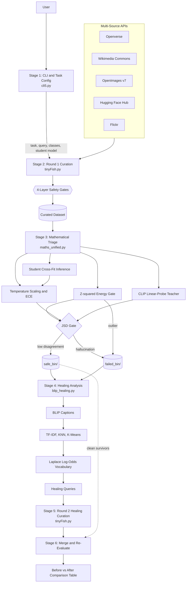
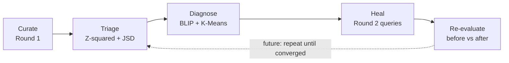
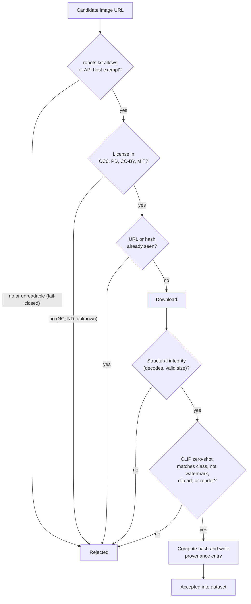
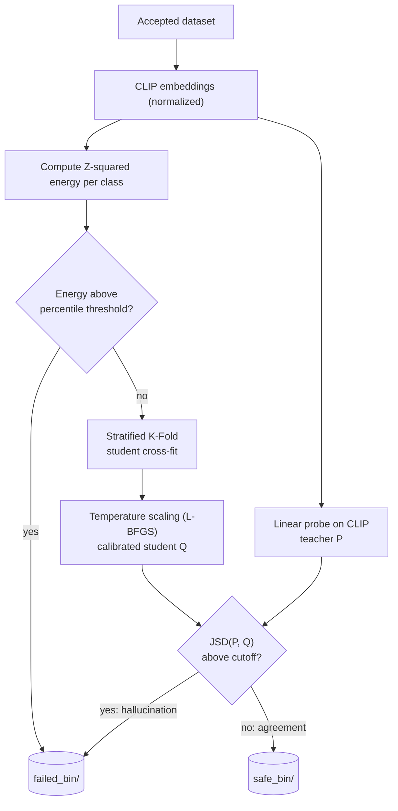
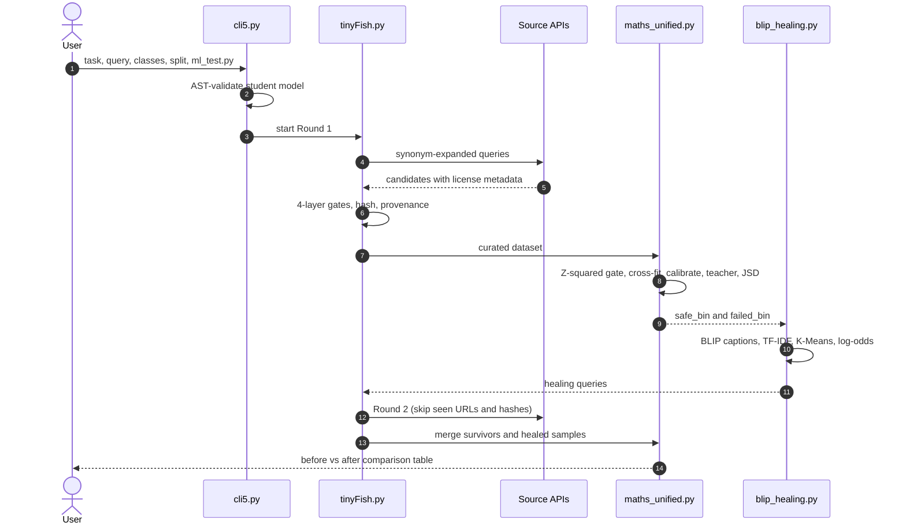
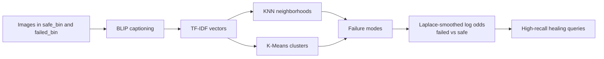

<div align="center">

# 🧬 OmniCompiler

### Autonomous Multi-Source, License-Aware Safe Image Retrieval & Self-Healing Pipeline

**Curate legally safe image datasets → mathematically triage them → let the pipeline heal its own blind spots.**


[Problem](#-problem-statement) •
[Solution](#-the-solution) •
[Architecture](#-system-architecture) •
[Pipeline](#-pipeline-stages) •
[Math](#-mathematical-foundations) •
[Install](#-installation) •
[Roadmap](#-roadmap)

</div>

---

## 📑 Table of Contents

- [Problem Statement](#-problem-statement)
- [The Solution](#-the-solution)
- [Key Features](#-key-features)
- [System Architecture](#-system-architecture)
- [Pipeline Stages](#-pipeline-stages)
- [The 4-Layer Data-as-Code Contract](#-the-4-layer-data-as-code-contract)
- [Data Sources](#-data-sources)
- [Compliance: robots.txt and CAPTCHAs](#-compliance-robotstxt-and-captchas)
- [Mathematical Foundations](#-mathematical-foundations)
- [Visual Analytics](#-visual-analytics)
- [Tech Stack](#-tech-stack)
- [Installation](#-installation)
- [Usage](#-usage)
- [Outputs](#-outputs)
- [Business Model and Feasibility](#-business-model-and-feasibility)
- [Roadmap](#-roadmap)
- [Contributing](#-contributing)
- [License](#-license)
- [Acknowledgements](#-acknowledgements)

---

## 🚨 Problem Statement

Building high-performing computer vision models requires **clean, diverse, and legally compliant** datasets. Traditional dataset creation is broken for four reasons:

| # | Bottleneck | What goes wrong |
|:-:|------------|-----------------|
| 1 | ⚖️ **Legal & copyright risk** | Scraping arbitrary web links captures commercial-restricted (`NC`), no-derivative (`ND`), or copyrighted images, creating serious compliance liability. |
| 2 | 🌫️ **Multimodal noise** | Search results and uncurated repositories return watermarked stock photos, vector clip art, 3D renders, corrupted files, and irrelevant backgrounds. |
| 3 | 📉 **Distribution drift & outliers** | Raw datasets contain noisy artifacts and out-of-distribution samples that degrade generalization and per-class accuracy. |
| 4 | 🎭 **Miscalibration & hallucinations** | Deep models are routinely overconfident. Without calibration and teacher–student agreement monitoring, silent failures go undetected. |

---

## 💡 The Solution

**OmniCompiler** is an autonomous **dataset curation, mathematical triage, and multimodal self-healing engine.**

It enforces a strict **4-Layer Data-as-Code Contract** guaranteeing:

- ✅ Domain safety
- ✅ Cryptographic provenance hashing
- ✅ License verification
- ✅ Structural integrity
- ✅ Dynamic CLIP zero-shot relevance gating

It then closes the loop with an **automated feedback cycle**:

1. Evaluates the student model's performance.
2. Isolates anomalies with **Z² Energy** and **Jensen-Shannon Divergence (JSD)** gates.
3. Analyzes failure modes with **BLIP captioning, KNN, and K-Means**.
4. Triggers a **targeted second-cycle curation pass** that heals dataset gaps autonomously.

> **Collect → Verify → Score → Diagnose → Heal → Re-evaluate.** No manual cleaning.

---

## ✨ Key Features

| Feature | Description |
|---------|-------------|
| 🔍 **Multi-source retrieval** | Openverse, Wikimedia Commons, OpenImages v7, Hugging Face Hub, Flickr, all via official APIs or open indexes. |
| 🧾 **License-aware** | Only `CC0`, `PD`, `CC-BY`, `MIT` pass. `NC` and `ND` are rejected. |
| 🔐 **Cryptographic provenance** | Every accepted image is hashed and logged to a provenance JSON manifest with attribution. |
| 🎯 **CLIP zero-shot gate** | Rejects off-topic images, watermarks, clip art, and 3D renders. |
| 📐 **Z² energy pruning** | Removes structural outliers in CLIP feature space. |
| 🌡️ **Temperature scaling + ECE** | L-BFGS calibration of student logits with calibration error reporting. |
| 👨‍🏫 **CLIP linear-probe teacher** | Independent teacher to cross-check the student. |
| 🚦 **JSD hallucination gate** | Flags samples where student and teacher strongly disagree. |
| 🩺 **BLIP failure analysis** | Captions, clusters, and extracts the vocabulary that defines failures. |
| ♻️ **Self-healing round 2** | Auto-generates healing queries and fills the exact target split. |
| 🔁 **Dedup memory** | Seen URLs and hashes persist across rounds. |
| 🛡️ **Fail-closed robots.txt** | RFC 9309 checker with cached domain rules. |
| 🧰 **Deterministic fallbacks** | Caching, synonym expansion, and API-first fallback for 100% split population. |
| 💻 **Interactive CLI** | Questionary + Rich UI with AST validation of the student model. |

---

## 🏗 System Architecture

### High-Level Pipeline



### Self-Healing Feedback Loop



### Candidate Admission Flow (per image)



### Triage Decision Flow (Stage 3)



### Runtime Interaction (sequence)



---

## 🔬 Pipeline Stages

### Stage 1: CLI & Task Configuration · `cli5.py`

Interactive terminal UI (Questionary + Rich) collects:

- The **vision task**
- The **dataset query** and **class labels**
- The **target split** sizes
- The **student model file** (`ml_test.py`), validated through **Abstract Syntax Tree (AST) inspection** before execution, so malformed or unsafe files fail fast.

### Stage 2: Round 1 Curation · `tinyFish.py`

- Queries **Openverse, Wikimedia Commons, OpenImages v7 CSV indices, Hugging Face Hub, and Flickr**.
- Uses **automated synonym expansion** to improve recall per class.
- Applies the **4-layer safety gates** to every candidate.
- Records URLs and hashes for deduplication.

### Stage 3: Mathematical Triage · `maths_unified.py`

| Step | Purpose | Result |
|------|---------|--------|
| **Z² Energy Gate** | Feature-wise z-score energy on CLIP embeddings. | Outliers → `failed_bin/` |
| **Student Inference** | Cross-fits the student across stratified folds. | Overall and per-class accuracy |
| **Temperature Scaling** | Optimizes scalar `T` via L-BFGS. | Calibrated logits, ECE |
| **CLIP Linear-Probe Teacher** | Linear head over normalized CLIP embeddings. | Teacher accuracy and probabilities |
| **JSD Gate** | Teacher–student disagreement. | Hallucinations → `failed_bin/`, clean → `safe_bin/` |

### Stage 4: Multimodal Healing Analysis · `blip_healing.py`



1. **BLIP** captions every image in `safe_bin/` and `failed_bin/`.
2. **TF-IDF** vectorizes captions.
3. **KNN** and **K-Means** cluster failures into interpretable modes.
4. **Laplace-smoothed log odds** rank the words that separate failures from safe images.
5. Top words become **high-recall healing queries**.

### Stage 5: Round 2 Healing Curation · `tinyFish.py`

- Re-runs curation with healing queries.
- **Preserves seen URLs and hashes**, so nothing is downloaded twice.
- Fills the **exact target split** specified in the CLI.

### Stage 6: Post-Healing Re-Evaluation

- Merges clean survivors with newly healed samples.
- Re-runs the full evaluation.
- Prints a **side-by-side comparison table** (before vs. after).

---

## 🧱 The 4-Layer Data-as-Code Contract

Every image must pass all layers to enter the dataset, like a **unit-test suite for data**.

| Layer | Name | Enforces |
|:----:|------|----------|
| **1** | 🌐 Domain & Access Safety | Fail-closed robots.txt (RFC 9309), approved API hosts, official programmatic sources only. |
| **2** | 🧾 License & Provenance | Only `CC0`, `PD`, `CC-BY`, `MIT`. Cryptographic hash and attribution recorded in the manifest. |
| **3** | 🧱 Structural Integrity | Image decodes, valid format and dimensions, not corrupted or truncated. |
| **4** | 🎯 CLIP Zero-Shot Relevance | Matches the target class; rejects watermarks, stock styling, vector art, and 3D renders. |

---

## 🌐 Data Sources

| Source | Access | Why it is safe |
|--------|--------|----------------|
| **Openverse** | Official REST API | Built-in license metadata, made for developers. |
| **Wikimedia Commons** | MediaWiki API | Structured JSON with license and author fields. |
| **OpenImages v7** | CSV indices | Pre-indexed IDs mapped to direct storage URLs; no frontend barriers. |
| **Hugging Face Hub** | Datasets Server REST API | Direct slicing over public vision datasets. |
| **Flickr** | API | License-filtered queries. |

---

## 🛡 Compliance: robots.txt and CAPTCHAs

### robots.txt (RFC 9309)

OmniCompiler ships a **fail-closed robots.txt checker** built on Python's `RobotFileParser`.

- Fetches and **caches** domain-level rules before downloading any asset.
- Identifies as the user agent **`OmniCompilerBot`**.
- **Fail-closed:** if rules cannot be fetched or parsed, the download is denied.

**API CDN exception.** Structured data providers serve media through public API contracts. These hosts are exempt from crawler blocks via `ROBOTS_EXEMPT_API_HOSTS`:

```
datasets-server.huggingface.co
cdn-lfs.hf.co
api.openverse.org
```

### CAPTCHAs

OmniCompiler **never bypasses CAPTCHAs** and avoids headless-browser scraping of consumer web pages. It uses only **official APIs and open data indexes**:

- **Openverse API & Wikimedia MediaWiki API**: structured JSON endpoints for developers
- **OpenImages v7 CSV indices**: metadata mapping image IDs to direct storage URLs
- **Hugging Face Datasets Server**: REST slicing over public datasets

> If a source needs a CAPTCHA, we do not use that route. We use the API built for programmatic access.

---

## 🧮 Mathematical Foundations

### 1. Z² Energy Outlier Gate

Detects out-of-distribution artifacts and noisy images in CLIP feature space (Stage 3).

$$Z = \frac{f - \mu}{\sigma + \epsilon}$$

$$E(f) = \sum_{d=1}^{D} Z_d^2$$

- $f$: CLIP embedding vector
- $\mu,\ \sigma$: per-class mean and standard deviation across feature dimensions
- $\epsilon = 10^{-6}$: avoids division by zero
- Samples above the configurable percentile threshold (e.g., 90th) go to `failed_bin/`.

### 2. Jensen-Shannon Divergence (JSD) Hallucination Gate

Measures disagreement between the CLIP teacher $P$ and calibrated student $Q$.

$$M = \tfrac{1}{2}(P + Q)$$

$$JSD(P \parallel Q) = \tfrac{1}{2} D_{KL}(P \parallel M) + \tfrac{1}{2} D_{KL}(Q \parallel M)$$

High JSD means the student is hallucinating or strongly disagreeing with the multimodal teacher. JSD is symmetric and bounded, which makes it a stable gating signal.

### 3. Temperature Scaling

A single scalar $T$ is fitted with L-BFGS by minimizing negative log-likelihood:

$$p_i = \mathrm{softmax}\!\left(\frac{z_i}{T}\right)$$

### 4. Expected Calibration Error (ECE)

Quantifies calibration before and after temperature scaling using $B$ confidence bins.

$$ECE = \sum_{m=1}^{B} \frac{|B_m|}{N} \left| \mathrm{acc}(B_m) - \mathrm{conf}(B_m) \right|$$

### 5. Laplace-Smoothed Log Odds

Used in `blip_healing.py` to find words that characterize failure clusters relative to safe images.

$$\mathrm{Score}(w) = \log\!\left(\frac{c_{\mathrm{failed}}(w) + 1}{N_{\mathrm{failed}} + V}\right) - \log\!\left(\frac{c_{\mathrm{safe}}(w) + 1}{N_{\mathrm{safe}} + V}\right)$$

$c(w)$ is word frequency, $N$ the total token count, and $V$ the vocabulary size, with $\alpha = 1$ Laplace smoothing.

### Summary

| Method | Stage | Question it answers |
|--------|:----:|---------------------|
| Z² Energy | 3 | Is this image a structural outlier? |
| Temperature scaling | 3 | Can the student's confidence be made honest? |
| ECE | 3 | How well calibrated is the student? |
| JSD | 3 | Do teacher and student disagree? |
| Laplace log odds | 4 | Which words describe why images fail? |

---

## 📊 Visual Analytics

Two diagnostic plots are generated automatically with Matplotlib. The examples below come from **Round 2 (post-healing)**.

### Z² Energy Distribution

<div align="center">

</div>

Histogram of Z² energy scores across the dataset. The dashed red line marks the **90th-percentile threshold (≈ 680)**. Images to the right of it are treated as structural outliers and routed to `failed_bin/`; everything to the left continues to the student and teacher evaluation.

### L-BFGS Temperature Scaling

<div align="center">

</div>

Negative log-likelihood (NLL) plotted against temperature $T$. The dashed green line marks the **optimal $T = 1.59$** found by L-BFGS, where NLL reaches its minimum (≈ 0.11). Since $T > 1$, the raw student was **overconfident**, and scaling softens its probabilities.

| File | Shows |
|------|-------|
| `z_square_energy_distribution.png` | Z² energy histogram with the percentile threshold separating clean data from anomalies routed to `failed_bin/`. |
| `calibration_curve.png` | NLL loss against temperature $T$, highlighting the optimal $T$ found by L-BFGS. |

---

## 🧰 Tech Stack

| Area | Technologies |
|------|--------------|
| **Language** | Python 3.10+ |
| **Deep learning & vision** | PyTorch, Torchvision, Hugging Face Transformers (`CLIPModel`, `CLIPProcessor`, `BlipForConditionalGeneration`, `BlipProcessor`) |
| **ML & clustering** | scikit-learn (`KMeans`, `NearestNeighbors`, `TfidfVectorizer`, `StratifiedKFold`) |
| **Validation & CLI** | Pydantic, Questionary, Rich |
| **Networking & parsing** | Requests, Pillow, `urllib` (`RobotFileParser`) |
| **Visualization** | Matplotlib |
| **Pretrained models** | `openai/clip-vit-base-patch32`, `Salesforce/blip-image-captioning-base` |

---

## ⚙️ Installation

**Prerequisites:** Python 3.10+, internet access to the source APIs, and optionally a CUDA GPU for faster CLIP/BLIP inference.

```bash
# 1. Clone
git clone https://github.com/<your-username>/OmniCompiler.git
cd OmniCompiler

# 2. Virtual environment
python -m venv venv
source venv/bin/activate          # Windows: venv\Scripts\activate

# 3. Dependencies
pip install -r requirements.txt
```

<details>
<summary><b>Manual dependency install (if no requirements.txt)</b></summary>

```bash
pip install torch torchvision transformers scikit-learn pydantic \
            questionary rich requests pillow matplotlib
```

</details>

---

## ▶️ Usage

```bash
python cli5.py
```

The CLI guides you through:

1. Choosing the vision task
2. Entering the dataset query and class labels
3. Setting target split sizes
4. Selecting your student model file (`ml_test.py`)

OmniCompiler then runs **Stages 2 → 6 automatically** and prints the before/after comparison table.

<details>
<summary><b>Student model requirements (<code>ml_test.py</code>)</b></summary>

Your PyTorch model file is validated by AST inspection before it is run. It must expose the class and interface that `cli5.py` expects (model class, constructor, `forward` signature, number of output classes). See `ml_test.py` in this repository for a working example.

</details>

---

## 📦 Outputs

| Artifact | Description |
|----------|-------------|
| `safe_bin/` | Samples that passed every gate |
| `failed_bin/` | Samples rejected by the Z² or JSD gate |
| `provenance.json` | Source URL, license, attribution, and cryptographic hash per image |
| `z_square_energy_distribution.png` | Outlier threshold visualization |
| `calibration_curve.png` | Temperature scaling visualization |
| Comparison table | Before vs. after healing |

### Demo run: Round 2 (post-healing) results

| Metric | Round 2 (healed) | Source |
|--------|:----------------:|--------|
| Optimal temperature $T$ | **1.59** | `calibration_curve.png` |
| Minimum NLL after scaling | **≈ 0.11** | `calibration_curve.png` |
| Z² outlier threshold (90th percentile) | **≈ 680** | `z_square_energy_distribution.png` |
| Images evaluated | **≈ 122** | `z_square_energy_distribution.png` |
| Flagged as Z² outliers | **≈ 12 (~10%)** | `z_square_energy_distribution.png` |
| Calibration verdict | Student overconfident ($T > 1$) | `calibration_curve.png` |

> Values marked ≈ are read from the plots. For exact figures, see the comparison table printed at the end of the run.

---

## 💼 Business Model and Feasibility

### Business model

- **B2B compliance-safe data engine.** Enterprises and AI labs face strict scrutiny over training-data provenance. OmniCompiler delivers cryptographically audited, fully attributed open-license datasets (`CC0`, `PD`, `CC-BY`, `MIT`) with provenance JSON manifests.
- **Automated DataOps SaaS.** A pipeline that continuously cleans, monitors, and heals production training distributions.

### Technical feasibility

- **Lightweight models.** `clip-vit-base-patch32` and `blip-image-captioning-base` run quickly on consumer GPUs and standard cloud CPUs.
- **Deterministic fallbacks.** Caching, synonym expansion, and API-first fallback ensure 100% split population even under transient network disruptions.
- **No fragile scraping.** Official APIs keep the pipeline stable and maintainable.

---

## 🗺 Roadmap

**Near term**
- [ ] Unit tests for each gate (license, hashing, robots, Z², JSD)
- [ ] YAML config for thresholds (Z² percentile, JSD cutoff, cluster count)
- [ ] Resume from checkpoint
- [ ] Async and parallel downloads
- [ ] SPDX license IDs and richer attribution in the manifest

**Mid term**
- [ ] Multi-round healing with automatic stopping criteria
- [ ] Larger CLIP/BLIP backends (ViT-L/14, BLIP-2)
- [ ] Near-duplicate detection (perceptual hashing + embeddings)
- [ ] Dedicated watermark and NSFW sub-gates
- [ ] Web dashboard (Streamlit or FastAPI)
- [ ] Object detection and segmentation datasets
- [ ] More sources (Europeana, Smithsonian Open Access, NASA, Met Museum)

**Long term**
- [ ] Hosted DataOps SaaS with continuous drift monitoring
- [ ] Active learning: prioritize healing by uncertainty
- [ ] Bias and fairness auditing
- [ ] Exportable dataset cards and compliance reports
- [ ] Plugin SDK for custom sources and gates
- [ ] Text, audio, and video modalities

---

## 🤝 Contributing

Contributions are welcome.

1. Fork the repository
2. Create a branch: `git checkout -b feature/your-feature`
3. Commit your changes: `git commit -m "Add your feature"`
4. Push: `git push origin feature/your-feature`
5. Open a Pull Request

Please open an issue first for large changes.

---

## 📄 License

Add your license here (for example, MIT) and include a `LICENSE` file in the repository root.

> **Note:** the license above applies to the OmniCompiler code. Curated images keep their own original licenses, which are recorded per image in `provenance.json`. Attribution is required for `CC-BY` content.

---

## 🙏 Acknowledgements

- [OpenAI CLIP](https://github.com/openai/CLIP) and [Salesforce BLIP](https://github.com/salesforce/BLIP)
- [Hugging Face Transformers](https://github.com/huggingface/transformers)
- [Openverse](https://openverse.org), [Wikimedia Commons](https://commons.wikimedia.org), [Open Images](https://storage.googleapis.com/openimages/web/index.html), [Flickr](https://www.flickr.com)
- PyTorch and scikit-learn communities

---

<div align="center">

**OmniCompiler: clean data, proven safe, healed automatically.**

</div>
